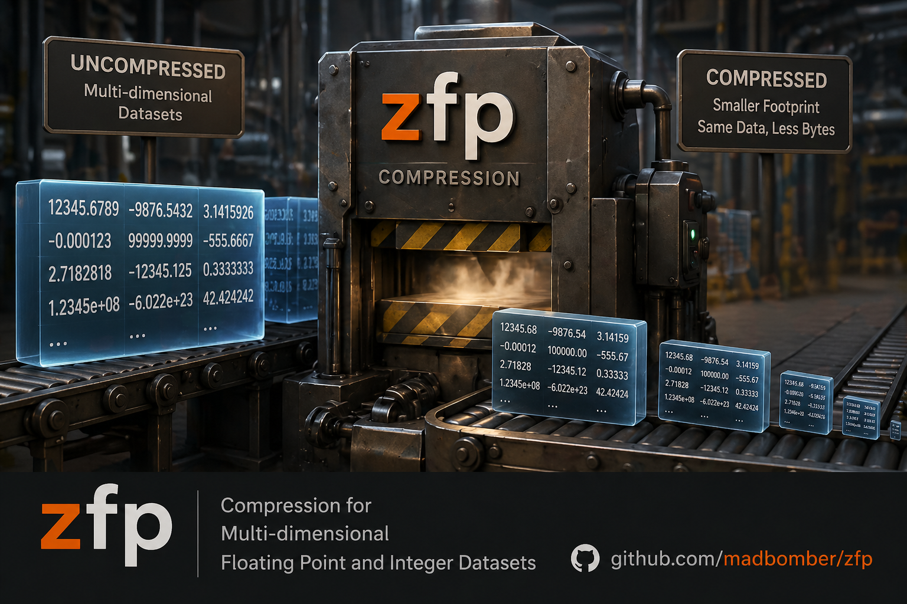

<div align="center">
  
  <br/>
  <i>Because your floats deserve better than Base64.</i>
</div>
<p>

The ZFP gem brings [LLNL's battle-hardened ZFP compression library](https://computing.llnl.gov/projects/zfp) to Ruby. ZFP was built by national-lab scientists to compress petabytes of floating-point simulation data without losing the ability to do science on it. Now it's in a Ruby gem. You're welcome, science.

Whether you're cramming ten years of OHLCV market data into Redis, shipping a million embedding vectors over the wire, or just deeply offended by how wasteful `Array#pack("E*")` is, this gem is for you.

---

## What ZFP Actually Does

ZFP compresses *n*-dimensional arrays of floats, doubles, int32s, and int64s — up to 4 dimensions — using a floating-point-aware transform that exploits spatial correlation across array elements. Unlike general-purpose compressors, it understands the structure of numeric data.

It offers four compression modes:

| Mode | What it does | Good for |
|---|---|---|
| `:reversible` | Bit-exact lossless | Audit trails, exact P&L, storing anything you'll diff |
| `:fixed_rate` | Guaranteed bits-per-value | Streaming, fixed-size storage slots |
| `:fixed_precision` | Guaranteed significant bits | Scientific reproducibility |
| `:fixed_accuracy` | Guaranteed absolute error bound | Financial data, ML embeddings, anything with a tolerance |

---

## Installation

You need `libzfp` installed first, with [upkg](https://github.com/seuros/upkg) or Homebrew:

```bash
upkg install zfp      # any platform
brew install zfp      # macOS
```

Then add the gem:

```bash
bundle add zfp
```

Or install directly:

```bash
gem install zfp
```

No native compilation. No waiting. The binding uses [ruby-ffi](https://github.com/ffi/ffi), so `gem install` is instant and the library loads at runtime.

---

## Five-Minute Quickstart

```ruby
require "zfp"

prices = [174.21, 174.85, 173.40, 175.10, 176.33]  # ... 10,000 more of these

# Lossless round-trip — bit-exact, no questions asked
compressed = Zfp.compress(prices, type: :double, shape: [prices.size], mode: :reversible)
restored   = Zfp.decompress(compressed, type: :double, shape: [prices.size], mode: :reversible)

prices == restored  # => true

# Self-describing pack — no metadata bookkeeping required
packed   = Zfp.pack(prices, type: :double, shape: [prices.size], mode: :reversible)
restored = packed.unpack       # type, shape, mode all embedded — no args needed

prices == restored  # => true

# Save to disk and load it back — a .zfp file needs no sidecar schema
packed.save("prices.zfp")
Zfp.load("prices.zfp").unpack == prices  # => true
```

That's it. The rest is just choosing how hard you want to squeeze.

---

## API Reference

There are three ways to use the gem. Pick whichever fits your architecture.

### Module methods — the easy path

**Raw bytes** (`compress` / `decompress`)

The caller manages metadata (type, shape, mode). Returns a plain `String` of compressed bytes.

```ruby
bytes = Zfp.compress(data, type: :double, shape: [1000], mode: :reversible)
data  = Zfp.decompress(bytes, type: :double, shape: [1000], mode: :reversible)

# Lossy — absolute error bounded to $0.001 per element
bytes = Zfp.compress(prices, type: :double, shape: [1000], mode: :fixed_accuracy, tolerance: 0.001)
data  = Zfp.decompress(bytes, type: :double, shape: [1000], mode: :fixed_accuracy, tolerance: 0.001)
```

**Self-describing bytes** (`pack` / `unpack` / `save` / `load`)

`pack` returns a `Zfp::Packed`: the compressed payload behind a 32-byte header holding type, shape, mode, and parameters. Pass it anywhere a `String` goes — Redis, S3, a message queue, `File.binwrite` — it converts via `to_str`. Unpack without needing a schema.

```ruby
# Pack: type/shape/mode/params stored in the bytes themselves
packed = Zfp.pack(data, type: :double, shape: [1000], mode: :fixed_accuracy, tolerance: 0.001)
packed            # => #<Zfp::Packed type=:double shape=[1000] mode=:fixed_accuracy tolerance=0.001 bytesize=2744>
packed.shape      # header fields are readable without decompressing
packed.bytesize

# Unpack: zero arguments needed
restored = packed.unpack          # or Zfp.unpack(packed), or Zfp.unpack(raw_string)

# Persist as a .zfp file and read it back
packed.save("prices.zfp")
loaded = Zfp.load("prices.zfp")   # => Zfp::Packed, metadata intact
loaded.unpack
```

The header is specific to this gem. Neither it nor the raw `compress` output (which carries no zfp header at all) can be read by the `zfp` command-line tool or by zfp bindings for other languages.

### `Zfp::Codec` — when you compress many arrays with the same config

Build a codec once. Compress forever.

```ruby
codec = Zfp::Codec.new(type: :double, shape: [252], mode: :fixed_accuracy, tolerance: 0.001)

# Same codec compresses each security's yearly price history
securities.each do |ticker|
  store[ticker] = codec.compress(daily_closes[ticker])
end

# Retrieve and decompress
prices = codec.decompress(store["AAPL"])

# Or pack (self-describing) via codec, and save it
codec.pack(daily_closes["AAPL"]).save("aapl.zfp")
```

---

## Multi-Dimensional Arrays

ZFP natively understands 1-D through 4-D structure. Providing the actual shape (not just total element count) lets it exploit correlation across all axes simultaneously — the more structure you describe, the better it compresses.

```ruby
# 1-D time series
Zfp.compress(prices, type: :double, shape: [252], mode: :reversible)

# 2-D matrix — e.g. 50 securities × 252 days
matrix = securities.flat_map { |s| daily_closes[s] }
Zfp.compress(matrix, type: :double, shape: [50, 252], mode: :fixed_accuracy, tolerance: 0.001)

# 3-D tensor — e.g. 10 portfolios × 30 securities × 252 days
Zfp.compress(tensor, type: :double, shape: [10, 30, 252], mode: :reversible)

# 4-D — ZFP supports up to 4 dimensions
Zfp.compress(data4d, type: :double, shape: [4, 8, 16, 16], mode: :reversible)
```

`shape:` is **row-major**: the order of a nested Ruby Array after `flatten`, and the order `Numo::NArray#shape` reports, with the last dimension varying fastest. libzfp numbers its axes the other way round (its `nx` is the fastest-varying one); the gem does that conversion internally, so never reverse a shape yourself. The product of the dimensions must equal the element count, or `Zfp::InvalidShape` is raised. See [Multi-Dimensional Arrays](https://madbomber.github.io/zfp/multi-dimensional/) for why this matters: described correctly, a smooth 100×120 grid compresses 15×; transposed, 6×.

---

## All Four Scalar Types

```ruby
# Floating-point — all modes available
Zfp.compress(floats,   type: :float,  shape: [n], mode: :reversible)
Zfp.compress(doubles,  type: :double, shape: [n], mode: :fixed_accuracy, tolerance: 1e-6)

# Integer — reversible mode only; any other mode raises Zfp::InvalidMode.
# Elements must be Integers within the 32-/64-bit signed range, or Zfp::InvalidType is raised.
Zfp.compress(counts,   type: :int32,  shape: [n], mode: :reversible)
Zfp.compress(ids,      type: :int64,  shape: [n], mode: :reversible)
```

---

## Numo::NArray Support

If you have required [numo-narray](https://github.com/ruby-numo/numo-narray), the gem auto-detects type and shape from Numo arrays. No `type:` or `shape:` arguments needed on compress or pack. For Numo *output* (`numo: true`, or unpacking bytes that were packed from a Numo array) the gem requires `numo/narray` on demand and raises `Zfp::NumoNotAvailable` if the gem is not installed.

```ruby
require "numo/narray"

# Input: Numo::DFloat — type (:double) and shape inferred automatically
closes = Numo::DFloat.cast(daily_prices).reshape(50, 252)
bytes  = Zfp.compress(closes, mode: :fixed_accuracy, tolerance: 0.001)
packed = Zfp.pack(closes,     mode: :reversible)

# Output: get a Numo array back with numo: true
result = Zfp.decompress(bytes, type: :double, shape: [50, 252], mode: :fixed_accuracy,
                               tolerance: 0.001, numo: true)
# => Numo::DFloat[50, 252]

# pack/unpack preserves Numo in → Numo out automatically
result = Zfp.unpack(packed)
# => Numo::DFloat[50, 252]

# All four Numo types supported:
#   Numo::SFloat  → :float
#   Numo::DFloat  → :double
#   Numo::Int32   → :int32
#   Numo::Int64   → :int64
```

---

## Compression Mode Guide

### `:reversible` — lossless, bit-exact

Use this when correctness is non-negotiable. Compression ratios depend entirely on how
predictable neighboring values are: smooth grids and sequences compress well; noisy
series and high-entropy data barely shrink.

```ruby
bytes = Zfp.compress(data, type: :double, shape: [n], mode: :reversible)
# Measured: 1.1x on simulated daily closes, 2.7x–5.8x on arithmetic sequences,
#           15x on a smooth 2-D grid. Measure on your own data before planning around a number.
```

### `:fixed_accuracy` — absolute error bound

The workhorse for financial and ML workloads. You set a maximum per-element error;
ZFP uses as few bits as needed to honor it.

```ruby
# Error on any finite element guaranteed ≤ tolerance (NaN/Infinity are not preserved in lossy modes)
bytes = Zfp.compress(prices, type: :double, shape: [n], mode: :fixed_accuracy, tolerance: 0.001)
# $0.001 per price point — indistinguishable for P&L calculations
# Measured: 2.7x–3.0x on simulated daily closes at tolerance 0.001;
#           2.8x → 4.8x on a sinusoid as tolerance rises from 0.001 to 1.0
```

### `:fixed_precision` — significant bits

Useful when you want to preserve a specific number of significant bits rather than
an absolute error bound. Handy for scientific data where relative precision matters more than absolute.

```ruby
bytes = Zfp.compress(data, type: :double, shape: [n], mode: :fixed_precision, precision: 20)
# precision is the bit budget per transform coefficient (up to 64 for a double, 32 for a float);
# it is not a mantissa-bit count. Error is relative to the largest value in each 4-element block.
```

### `:fixed_rate` — guaranteed bytes per value

Use when you need fixed-size storage slots — e.g., each block in a columnar store
must be exactly the same size. The `rate` is bits per scalar value.

```ruby
bytes = Zfp.compress(data, type: :double, shape: [n], mode: :fixed_rate, rate: 16.0)
# 16 bits per value → 4x smaller than raw double
# WARNING: aggressive rates (< 8) can produce large errors on high-dynamic-range data.
#          Always validate max_err against your tolerance before committing to a rate.
# NOTE:    libzfp enforces a per-block minimum (about 3 bits/value for 1-D doubles); lower
#          requests are rounded up and the output is sized by the rate actually applied.
```

---

## Real-World Performance

Benchmarked on 5 portfolios of 14–29 securities × 252 trading days of close prices
(synthetic GBM data, seed 42, `examples/02_portfolio_performance.rb`):

| Mode | Ratio | Max Error |
|---|---|---|
| `:reversible` | 1.0×–1.1× | 0 (exact) |
| `:fixed_accuracy, tolerance: 0.001` | 2.7×–3.0× | $0.00035 |

Independent GBM paths are a hard case: there is no cross-security correlation for the 2-D
transform to exploit, and daily returns are pure noise. Real market data (correlated sectors,
macro moves) should do better, but measure before you plan around a number. We have not yet
benchmarked ML embedding vectors; the tolerance sweep in the docs shows how to measure your own.

---

## Error Handling

```ruby
Zfp::LibraryNotFound     # libzfp not installed or not found
Zfp::NumoNotAvailable    # Numo output requested but numo-narray is not installed
Zfp::InvalidType         # unrecognized :type, non-Array data, or integer data out of range
Zfp::InvalidMode         # unrecognized :mode, or a lossy mode with an integer type
Zfp::InvalidShape        # bad shape, or shape product ≠ number of elements
Zfp::InvalidParams       # missing or invalid mode-specific param (rate/precision/tolerance)
Zfp::CompressionFailed   # libzfp returned an error during compress
Zfp::DecompressionFailed # empty input, truncated :fixed_rate stream, or libzfp error
Zfp::PackerError         # corrupt, truncated, or 0.1.0 multi-dimensional pack header
```

Decompressing with the wrong type, shape, mode, or parameters **cannot** be detected for raw
`compress` output: the bytes carry no header, so you get a full-size array of garbage, not an
error. The gem only guarantees that this is memory-safe. Use `pack`/`unpack` when the
parameters need to travel with the data.

All inherit from `Zfp::Error < StandardError`.

---

## When to Use This Gem

- **In-memory caches of numerical time series** — compress to a byte string, store in Redis,
  decompress on demand. Transparent to the rest of your code.
- **Columnar financial data** — years of OHLCV for thousands of tickers at a fraction of raw size.
- **ML embedding storage** — vectors stay geometrically faithful under `:fixed_accuracy` at
  tolerances that preserve cosine similarity.
- **Message queues** — pack/unpack means the consumer needs no schema; bytes are self-describing.
- **Checkpointing numerical computation** — `pack(...).save("step.zfp")` intermediate Numo arrays between steps; `Zfp.load` restores them with shape and type intact.

## When Not to Use This Gem

- **Random or already-compressed data** — ZFP assumes spatial correlation. Noise, encrypted data,
  and random floats will barely shrink and may grow.
- **Text, blobs, or non-numeric data** — use MessagePack, zstd, or zlib.
- **Tiny arrays (< ~50 elements)** — the 32-byte pack header plus ZFP block overhead dominates.
- **Integer data needing lossy compression** — integer types support `:reversible` only.

---

## Examples

```bash
bundle exec ruby examples/01_basic_usage.rb
bundle exec ruby examples/02_portfolio_performance.rb
```

---

## Requirements

- Ruby ≥ 3.0
- libzfp 1.0+ — install with [upkg](https://github.com/seuros/upkg): `upkg install zfp`
- [ffi](https://github.com/ffi/ffi) ~> 1.0 (installed automatically)
- [numo-narray](https://github.com/ruby-numo/numo-narray) _(optional — required on demand for Numo output)_

---

## Development

```bash
git clone https://github.com/madbomber/zfp
cd zfp
bundle install
bundle exec rake test
```

Tests that require libzfp are automatically skipped if the library isn't found,
so the suite is safe to run anywhere.

---

## Contributing

Bug reports and pull requests are welcome at https://github.com/madbomber/zfp.
Please include a failing test for bugs and a passing test for features.

---

## References

- [ZFP — Compressed Floating-Point and Integer Arrays](https://computing.llnl.gov/projects/zfp) — official project page at Lawrence Livermore National Laboratory
- [ZFP on GitHub](https://github.com/LLNL/zfp) — source, documentation, and compression algorithm details

---

## License

MIT. Go nuts. See [LICENSE](LICENSE).
